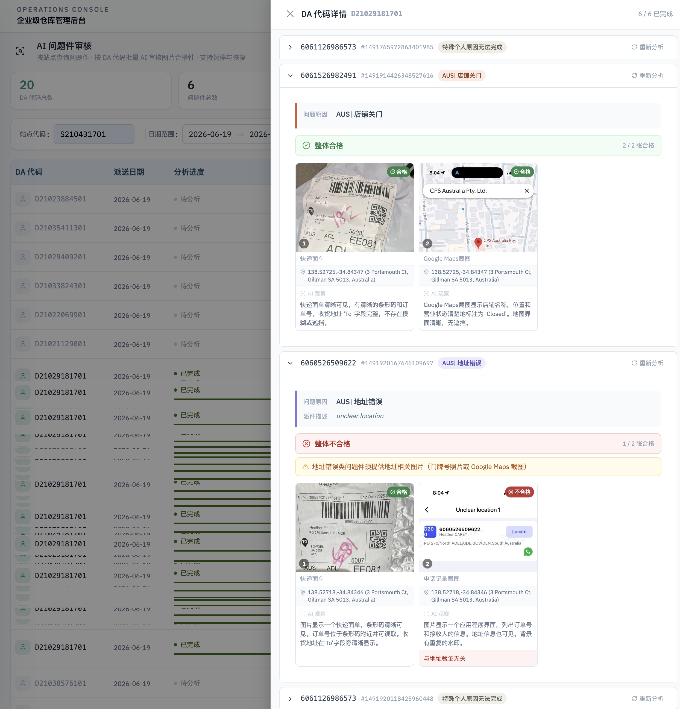
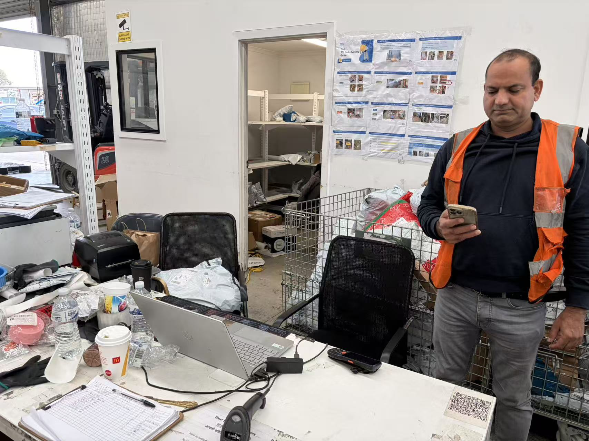

# AI 问题件审核 —— 从图片合规到派件员现场指导

> 内部 AI 先行者实践案例 · 配图来自 `ai分析2` 文件夹  
> 适用场景：公司群推广、站点管理分享、POD 规范培训引用

---

## 我们在解决什么问题

末端派件上报「问题件」时，派件员会上传一组 POD 图片：快递面单、通话记录、门牌号、Google Maps 截图等。过去靠人工逐单翻看，耗时长、标准不统一，也很难快速定位**哪些派件员反复上传不合格证据**。

**AI 问题件审核**的做法是：系统按站点、日期拉取问题件，再按 **DA 代码**（派件员）批量调用视觉模型，逐张判断图片是否合格，并给出「整体合格 / 整体不合格」结论。管理者打开详情即可看到每一张图的类型、AI 观察描述与不合格原因——**点名到人，再去做现场指导**。

---

## 系统怎么工作

### 1. 查询与批量审核

1. 选择**站点代码**、**日期范围**，查询该时段内各 DA 的问题件统计；
2. 点击「开始分析」，系统逐单拉取问题件详情（问题类型、派件员备注、上传图片）；
3. 视觉模型逐张审核，支持**暂停与恢复**，大批量也不丢进度。

页面顶部汇总：**DA 代码总数、问题件总数、合格件数、不合格件数**。

### 2. AI 审核逻辑（核心）

对每一单问题件，AI 按固定流程处理：

| 步骤 | 说明 |
|------|------|
| **读取背景** | 系统问题类型（如「店铺关门」「地址错误」）+ 派件员补充描述 |
| **匹配规则** | 根据问题类型动态加载审核标准（店铺关门 / 无人在家 / 地址错误 / 拒收等） |
| **逐图分析** | 先写 `observation`（描述所见），再判 `imageType`，最后给 `qualified` 与 `reason` |
| **提取水印** | 若图片左下角有 GPS + 地址水印，提取最后一行原文 |
| **结构性校验** | 服务端硬规则与 AI 结论合并，得出「整体合格 / 整体不合格」 |

#### 审核标准 A — 快递面单（所有问题件必有一张）

面单须同时满足：

- 条形码清晰可见、未被遮挡；
- 条形码附近有可读的订单号；
- 「To」字段收货地址完整、无模糊或截断。

#### 审核标准 B — 证据图片（按问题类型）

| 问题类型 | 证据须证明什么 | 典型合格证据 |
|----------|----------------|--------------|
| **店铺关门** | 派送时店铺确实关闭 | Google Maps 显示 Closed、卷帘门关闭、门口「Closed」告示 |
| **无人在家** | 收件人不在家或联系不上 | 通话记录（含号码+时间+状态）、住宅门口照片 |
| **地址错误** | 面单地址与实际不符或不存在 | 门牌号照片、Google Maps 显示地址不匹配 |
| **拒收** | 收件人明确拒签 | 短信/聊天截图、通话记录 |

#### 服务端硬规则（代码层兜底）

- **规则 1**：任何问题类型都必须包含至少一张「快递面单」图片；
- **规则 2**：「地址错误」类必须另有门牌号或 Google Maps 截图，仅有通话记录不算合格证据。

> 设计原则：Chain-of-Thought 先描述再判断；面单与证据分层审核；负样本锚定减少误判；缺数据不猜测。

---

## 图 1 · 系统截图：AI 批量审核与逐单详情



*图 1：按站点查询 → 按 DA 批量分析 → 抽屉内逐单查看 AI 结论*

### 截图中的真实案例

**案例 A · 整体合格（6061526982491）**

- 问题类型：**店铺关门**
- 图片 1（快递面单）：条形码、订单号、To 地址均清晰 → **合格**
- 图片 2（Google Maps 截图）：地图显示店铺名称、位置，营业状态为 **Closed** → **合格**
- 结论：**整体合格** — 面单规范 + 证据与上报原因一致

**案例 B · 整体不合格（6060526509622）**

- 问题类型：**地址错误**（派件员备注：unclear location）
- 图片 1（快递面单）：清晰 → **合格**
- 图片 2（通话记录截图）：AI 判定 **与地址验证无关** → **不合格**
- 系统提示：地址错误类问题件须提供**门牌号照片或 Google Maps 截图**
- 结论：**整体不合格** — 不是「没拍照」，而是**拍错了类型**

### 这一页说明什么

AI 不是在数图片张数，而是在做**内容与问题类型的匹配**：

- 报「店铺关门」，就要有能证明「关着」的证据（如 Maps 显示 Closed）；
- 报「地址错误」，就要有能证明「地址对不上」的证据，通话记录不能替代。

站点管理者可以按 DA 代码筛出**不合格件数多、反复犯同一类错误**的派件员，作为培训名单，而不用人工翻几百张图。

---

## 图 2 · 落地动作：根据 AI 结论做 POD 现场指导



*图 2：针对 POD 规范不足的派件员，结合《ATL Safe Delivery Guide》等标准做一对一现场带教*

### 从「AI 判不合格」到「人去纠正」

系统给出不合格原因后，管理动作可以很具体：

1. **按 DA 汇总**：哪些派件员不合格件多、常见问题是缺面单、证据类型不对、还是 Maps/门牌号不规范；
2. **按问题类型培训**：地址错误 → 教怎么拍门牌号、怎么截 Maps；店铺关门 → 教怎么截营业状态；
3. **对照标准样张**：墙上张贴 ATL Safe Delivery Guide 等合格 POD 示例，派件员对照手机里的历史问题件复盘；
4. **复检闭环**：下一周期再跑 AI 审核，看同一 DA 的合格率是否上升。

图 2 中的场景正是这一闭环：**AI 负责批量筛人、标原因；主管负责现场讲规范、看实操。**

---

## 一条可复制的 AI 落地路径

```
业务数据（iMile 问题件 + 上传图片）
        ↓
视觉 AI 逐张审核（类型匹配 + 面单/证据分层 + 硬规则兜底）
        ↓
按 DA 输出合格 / 不合格及具体原因
        ↓
管理者点名培训、张贴 POD 标准、复检跟踪
```

与「开仓效率 / 分拣员效率 / 异常订单分析」一样，**AI 问题件审核**也不是停在屏幕上的演示：

- **输入**：真实问题件图片 + 问题类型；
- **输出**：可执行的合格性结论与逐图原因；
- **动作**：找到缺乏 POD 规范的派件员，做现场指导。

---

## 给同事的一句话

如果你也在做末端质量、问题件复核或派件员管理，可以从**一个站点、一天数据、一个 DA 代码**试跑 AI 审核：先看系统怎么判，再对照现场该怎么教。  
有接入需求或想一起看不合格样例的，欢迎找本案例负责人交流。

---

*内部资料，请勿对外传播*
